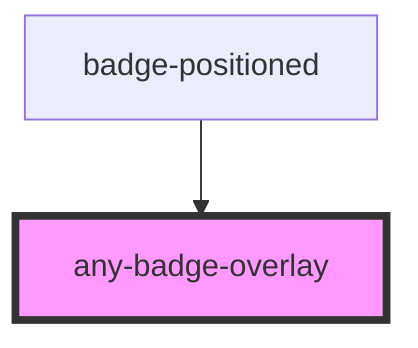

# any-badge-overlay

<!-- Auto Generated Below -->

## Properties

| Property     | Attribute     | Description                   | Type     | Default |
| ------------ | ------------- | ----------------------------- | -------- | ------- |
| `styleClass` | `style-class` | Style class of the component. | `string` | `null`  |

## Slots

| Slot | Description      |
| ---- | ---------------- |
|      | The default slot |

## Dependencies

### Used by

 - [badge-positioned](../app-showcase/pages/badge/badge-positioned)

### Graph

----------------------------------------------

*Built with love by **AdaleksTech!***
