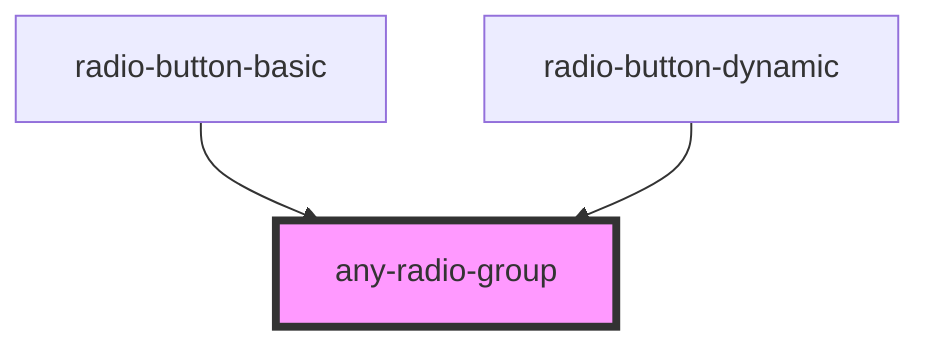

# any-radio-group

<!-- Auto Generated Below -->

## Properties

| Property              | Attribute               | Description                                                     | Type      | Default        |
| --------------------- | ----------------------- | --------------------------------------------------------------- | --------- | -------------- |
| `allowEmptySelection` | `allow-empty-selection` | If `true`, the radios can be deselected.                        | `boolean` | `false`        |
| `name`                | `name`                  | The name of the control, which is submitted with the form data. | `string`  | `this.inputId` |
| `value`               | `value`                 | the value of the radio group.                                   | `any`     | `undefined`    |

## Events

| Event         | Description                         | Type                                            |
| ------------- | ----------------------------------- | ----------------------------------------------- |
| `valueChange` | Emitted when the value has changed. | `CustomEvent<RadioGroupChangeEventDetail<any>>` |

## Dependencies

### Used by

 - [radio-button-basic](../app-showcase/pages/radio-button/radio-button-basic)
 - [radio-button-dynamic](../app-showcase/pages/radio-button/radio-button-dynamic)

### Graph

----------------------------------------------

*Built with love by **AdaleksTech!***
