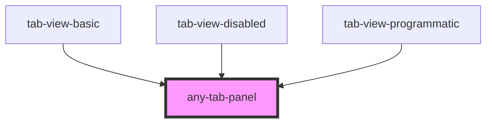

# any-tab-panel

<!-- Auto Generated Below -->

## Properties

| Property   | Attribute  | Description                         | Type      | Default |
| ---------- | ---------- | ----------------------------------- | --------- | ------- |
| `disabled` | `disabled` | When true, tab cannot be activated. | `boolean` | `false` |
| `header`   | `header`   | Title of the tabPanel.              | `string`  | `null`  |
| `selected` | `selected` | Defines if tab is active.           | `boolean` | `false` |

## Slots

| Slot | Description      |
| ---- | ---------------- |
|      | The default slot |

## Dependencies

### Used by

 - [tab-view-basic](../app-showcase/pages/tab-view/tab-view-basic)
 - [tab-view-disabled](../app-showcase/pages/tab-view/tab-view-disabled)
 - [tab-view-programmatic](../app-showcase/pages/tab-view/tab-view-programmatic)

### Graph

----------------------------------------------

*Built with love by **AdaleksTech!***
